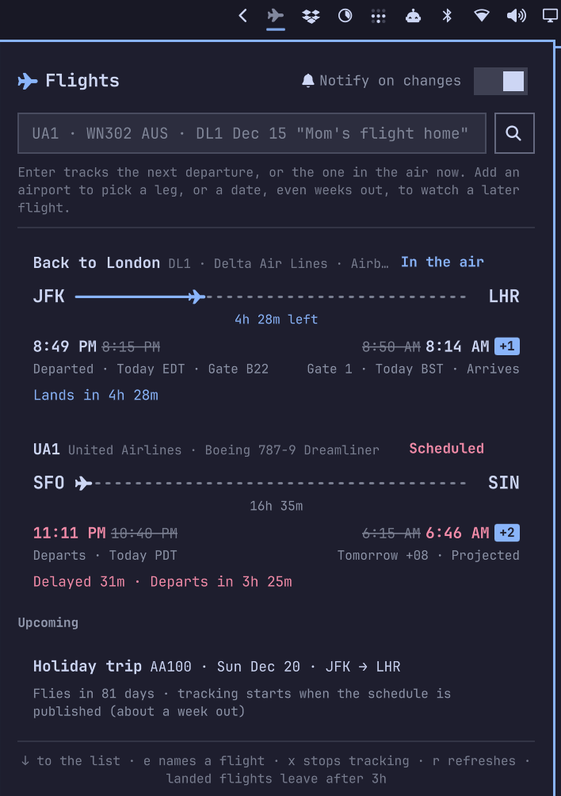

# Flights

Track flights from your [Omarchy](https://omarchy.org) bar. Click the plane,
type a flight number, and press Enter. You get live status, delays, gates,
and a notification whenever something changes. Flights leave the list three
hours after they land.

<p align="center">
  
</p>

- **Type it however you like.** `UA1`, `ua 1`, `WN302 AUS`, `DL1 Dec 15`,
  `B6 1 tomorrow`.
- **It picks the right flight.** It takes the one in the air now, or else the
  next departure. If the number flies more than one route that day, it asks
  which one you mean.
- **Name your flights.** `DL2402 "Mom's flight home"`. Notifications then say
  *Mom's flight home (DL2402) took off*.
- **Plan weeks ahead.** Flights beyond the published schedule wait on an
  Upcoming list and start tracking on their own once they're scheduled.
- **No account or API key needed.**

## Install

```bash
omarchy plugin add https://github.com/Evansbee/omarchy-plugin-flights.git --enable
```

Omarchy warns that plugins run unsandboxed inside your shell, asks you to
confirm, and asks which bar section to use (right is the default). The plane
appears in the bar right away. No restart is needed.

**Update:** `omarchy plugin update evansbee.flights` shows the diff, then
fast-forwards.

**Move it:** `omarchy bar move evansbee.flights --section center`

**Remove:** `omarchy plugin remove evansbee.flights`. Your saved flights stay
in `~/.local/state/omarchy-flights/` in case you come back. Delete that
folder too for a clean slate.

You need Omarchy with the Quickshell-based `omarchy-shell`, plus `curl` and
`notify-send`. Omarchy ships all three.

## Using it

### Adding a flight

Click the plane. The cursor is already in the box. Type and press Enter.

| You type | It tracks |
|---|---|
| `UA1` | The UA1 in the air right now. If none is airborne, the next one to depart. |
| `WN302` | If WN302 flies more than one route that day (MCI → AUS, then AUS → DAL), the panel lists them so you can pick. |
| `WN302 AUS` | The leg that starts or ends at AUS. |
| `WN302 MCI-AUS` | Exactly that leg. |
| `DL1 10/3`, `DL1 Dec 15`, `DL1 2026-12-15`, `DL1 tomorrow` | That day's flight. |
| `DL1 Dec 15 "Holiday trip"` | Any of the above, with a name. |

Dates are matched in the **departure airport's** local time, the date printed
on your boarding pass. A date without a year that has already passed means
next year. A daily flight repeating every 24 hours never triggers the
"which one?" question. The question only appears when one number flies
different routes within the same trip.

### Flights weeks out

Flightradar24 publishes schedules about a week ahead. When you add a flight
further out than that, it goes onto the **Upcoming** list, showing the
flight's usual route when there's only one. It's checked once a day, then
every three hours from nine days out. When the schedule includes it, it
switches to live tracking and you get a notification. If that day turns out
to fly more than one route, the card asks you to pick. Upcoming flights that
never appear are dropped a day after their date.

### Reading a card

- **Route line:** the plane sits at the flight's real progress. Under the
  line is the total flight time before departure, the time left in the air,
  and the time it took after landing.
- **Times** use each airport's local time, in 12-hour format. When a time
  changes, the original appears beside it, struck through.
- **+1** (in your theme's accent color) means the flight lands on a later
  calendar day than it left. Long-hauls can show +2, and eastbound flights
  across the dateline can show −1.
- **Projected** next to an arrival means the departure slipped but
  Flightradar24 hasn't published a new arrival yet. The arrival is moved by
  the same delay until it does.
- **Gates and terminals** appear once the airline publishes them.

### Notifications

Turn on **Notify on changes** in the popup header. You'll hear about:

- Taxiing, takeoff, and landing
- Departure or arrival time moving 5+ minutes (adjustable with
  `changeMinutes`)
- Gate assignments and gate changes
- Cancellations and diversions, sent as urgent

Several changes found in the same check arrive as one notification. Times
are compared against what you were last *told*, so an estimate that creeps a
minute at a time still alerts you once it has moved 5 minutes. Nothing is
sent for the first check after you add a flight, because you're already
looking at it.

### The bar icon

A single solid plane that stays still. It slowly breathes (dims a little and
comes back) only while a tracked flight is in the air. It turns your theme's
urgent color if a flight is canceled or diverted. Hover over it for a
one-line summary of each flight.

### Keys and clicks

| | |
|---|---|
| Left-click the plane | Open the popup |
| Middle-click the plane | Re-check every flight now |
| `Enter` in the box | Look up the flight |
| `↓` / `↑` | Move between the box and the list |
| `Enter` on a choice | Track that leg |
| Click a flight's name, or `e` | Rename it. `Enter` saves, `Esc` cancels, and saving it empty goes back to the flight number. |
| `x`, or the × on hover | Stop tracking it |
| `r` | Refresh everything |
| `Esc` | Dismiss a question, or close |

## Settings

Add any of these to the widget's entry in `~/.config/omarchy/shell.json`.
Changes apply as soon as you save.

```json
{ "id": "evansbee.flights", "dropAfterHours": 2, "changeMinutes": 10 }
```

| Key | Default | Meaning |
|---|---|---|
| `dropAfterHours` | `3` | Hours a landed flight stays on the list |
| `changeMinutes` | `5` | How far a departure or arrival time must move before you're notified |
| `animate` | `true` | Breathe the plane while a flight is in the air |
| `iconFont` | `~/Resources/fontawesome_font/otfs/Font Awesome 7 Pro-Solid-900.otf` | Path to a Font Awesome 7 **Pro** Solid font file |

**Icons:** if you own Font Awesome 7 Pro, point `iconFont` at its Solid
`.otf` file and the plugin loads it at runtime. Pro is licensed per person,
so it's never bundled. Without it, the plugin uses Font Awesome 7 Free, which
Omarchy installs. If that's missing too, it uses the bar's Nerd Font.

Tracked flights, upcoming flights, and the notification switch are saved in
`~/.local/state/omarchy-flights/flights.json`, so they survive restarts.

## Where the data comes from

Flight data comes from Flightradar24's public web endpoints, the same ones
its website uses:

- **`api.flightradar24.com/common/v1/flight/list.json`**: every recent and
  upcoming departure of a flight number, with scheduled, estimated, and
  actual times and a status.
- **`data-live.flightradar24.com/clickhandler/`**: once the aircraft is live,
  its position and ground speed (which distinguishes taxiing from parked),
  plus gates.

These endpoints are unofficial and undocumented. Treat this plugin as a
personal tool: Flightradar24 could change or block the endpoints at any
time, and the plugin keeps its traffic deliberately light.

| Flight is… | Checked every |
|---|---|
| More than a day out | 30 min |
| Within 24 hours | 10 min |
| Within 3 hours | 2 min |
| At the gate, taxiing, or in the air | 1 min |
| Landed (until it drops off) | 10 min |
| On the Upcoming list | Daily, then every 3 h from 9 days out |

Requests go out one at a time. If Flightradar24 refuses (403) or
rate-limits (429), all polling pauses for five minutes.

## Troubleshooting

The plugin answers over IPC:

```bash
omarchy-shell flights status             # every flight: phase, times, next check, errors
omarchy-shell flights track "UA1 Dec 15" # same as typing in the box
omarchy-shell flights rename "<key>" "Mom's flight home"
omarchy-shell flights remove "<key>"     # keys are listed by status
omarchy-shell flights refresh            # re-check everything now
omarchy-shell flights notify false       # the popup's switch
omarchy-shell flights testNotification   # send a sample notification
```

Lookups, phase changes, and notifications are logged with a `flights` prefix
in the shell log at `/run/user/$UID/quickshell/by-id/*/log.log`.

## Development

```bash
git clone https://github.com/Evansbee/omarchy-plugin-flights.git
cd omarchy-plugin-flights
node --test test/
```

`Model.js` holds the parsing, flight selection, phase logic, change
detection, and formatting. It touches no Qt API, so the tests run under
plain node against trimmed, real Flightradar24 responses in
`test/fixtures/`.

To run a checkout live, link it into the shell's plugin folder:

```bash
ln -sfn "$PWD" ~/.config/omarchy/plugins/evansbee.flights
omarchy-shell shell rescanPlugins
omarchy plugin enable evansbee.flights
```

A symlinked plugin does not hot-reload, because the shell's file watcher
doesn't follow symlinks. Run `omarchy restart shell` after edits.

| File | What it is |
|---|---|
| `manifest.json` | Plugin manifest: a `service` plus a `bar-widget`, with settings schema |
| `Service.qml` | The tracker. Polling, persistence, notifications, IPC. One per session. |
| `BarWidget.qml` | The bar icon, icon font loading, and popup host. One per monitor. |
| `Panel.qml` | The popup |
| `Model.js` | Pure logic, tested under node |
| `icon.svg` | Notification icon |

## License

MIT. Font Awesome Pro is not included, and your own Font Awesome license
covers your copy.
